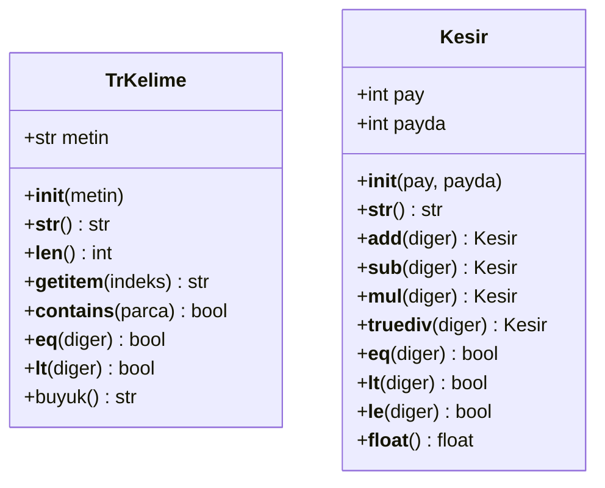

# Hafta 8 – UML Sınıf Diyagramı (Fatih Yumuşak – 20253006032)

`TrKelime` sabit `ALFABE = "abcçdefgğhıijklmnoöprsştuüvyz"` değerini kullanır;
`Kesir` sadeleştirme için `ebob(a, b)` fonksiyonunu kullanır.
